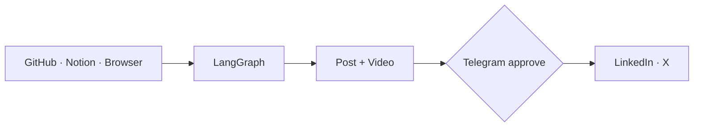
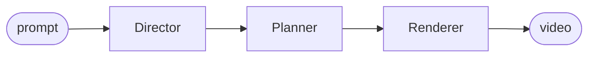

<div align="center">


<br/>

<a href="https://vamsicheruku.com"></a>
<a href="https://linkedin.com/in/vamsi-cheruku"></a>
<a href="https://x.com/cheruku_vamsi"></a>
<a href="mailto:vamsicheruku027@gmail.com"></a>


<br/><br/>

<picture>
  <source media="(prefers-color-scheme: dark)" srcset="https://raw.githubusercontent.com/Vamsi-027/Vamsi-027/output/github-snake-dark.svg" />
  
</picture>

</div>

---

```console
vamsi@cheruku:~$ neofetch
---------------------------------------------------------------
 kernel     3 yrs backend & distributed systems @ Zoho
 runtime    MS Artificial Intelligence @ Saint Louis University
 shell      java · python · typescript
 packages   langgraph · kafka · redis · k8s · remotion · mcp
 building   autonomous agents · multi-agent pipelines · llm → video infra
 philosophy failure modes before prompts
 deploy     prod > localhost
 status     ● open to founding eng · ai infra · agentic ai · distributed systems · video ai
---------------------------------------------------------------
vamsi@cheruku:~$ █
```

---

## AgentEcho

An agent that turns my daily engineering work into posts and videos, then publishes them. It has already posted on its own.



`Python` `LangGraph` `Remotion` `ElevenLabs` `SQLite`

---

## AgentMotif

Type a prompt, get a motion graphic. Three agents, each with one job.



`Python` `TypeScript` `Remotion` `LLMs`

---

## AlsoShipped

- **[Back2Cards](https://www.back2cards.fun/)**: real-time multiplayer card game (WebSockets + WebRTC)
- **[SamCars](https://saamcars.com)**: dealership management platform (Node, Postgres)
- **Entropy.me**: chat with past, present and future versions of yourself (Supermemory hackathon)

---

## TechStack

<p align="center">
  
</p>

<p align="center">
  <code>LangGraph</code> <code>MCP</code> <code>RAG</code> <code>Remotion</code> <code>FFmpeg</code>
</p>

---

## LearningNow

```diff
+ agent memory
+ context engineering
+ agent evals
+ video infra for LLMs
```

---

## LetsTalk

Building agents that need to work in production? **[vamsicheruku027@gmail.com](mailto:vamsicheruku027@gmail.com)**
