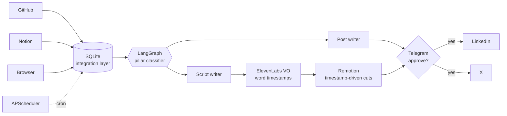
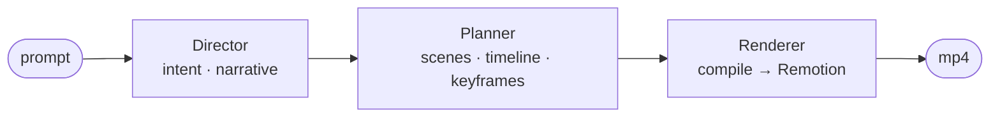

<div align="center">


<br/>

<a href="https://vamsicheruku.com"></a>
<a href="https://linkedin.com/in/vamsi-cheruku"></a>
<a href="https://x.com/cheruku_vamsi"></a>
<a href="mailto:vamsicheruku027@gmail.com"></a>


</div>

---

```ts
const vamsi = {
  past:    "3 yrs backend & distributed systems @ Zoho",
  now:     "MS AI @ Saint Louis University",
  builds:  ["autonomous agents", "multi-agent pipelines", "LLM → video infra"],
  thinks:  "queues, retries & failure modes before prompts",
  ships:   "to prod. not localhost.",
  open_to: ["Founding Eng", "AI Infra", "Agentic AI", "Distributed Systems", "Video AI"],
} as const;
```

---

## 🛰️ agent echo &nbsp;·&nbsp; `it does my dev marketing. i just tap approve.`

An autonomous agent that watches what I build, writes about it, renders a narrated video, and publishes it.
**It has already shipped a post without me touching a keyboard.**



- Word-level voiceover timestamps **decide where shots cut**. No hand editing.
- Spring-physics motion and a codified design system for type, cut types and color grading
- Human-in-the-loop over Telegram: autonomous, but nothing goes out without a yes

`Python` `LangGraph` `Remotion` `ElevenLabs` `SQLite` `APScheduler`

---

## 🎬 agent motif &nbsp;·&nbsp; `motion design, compiled.`

Plain English in, rendered motion graphics out. Each agent owns exactly one layer of abstraction, so you debug **one stage at a time** instead of one giant prompt.



`Python` `TypeScript` `Remotion` `LLMs` `Multi-Agent`

---

## 🧪 also shipped

| project | what | proof |
|---|---|---|
| 🃏 **Back2Cards** | real-time multiplayer card game · WebSockets + WebRTC | [▶ live](https://www.back2cards.fun/) |
| 🧠 **Entropy.me** | temporal memory graph: talk to your past / present / future self | Supermemory hackathon |
| 🏥 **MediBuddy** | AI assistant for patient workflows · Next.js, Node, Postgres | — |
| 🚗 **SamCars** | dealership management platform · Node, Express, Postgres | — |

---

## 🧱 stack

<p align="center">
  <br/>
  
</p>

<p align="center">
  <code>LangGraph</code> <code>MCP</code> <code>RAG</code> <code>Context Engineering</code> <code>OpenAI</code> <code>Anthropic</code> <code>Gemini</code> <code>Remotion</code> <code>FFmpeg</code> <code>ElevenLabs</code>
</p>

---

## 📈 receipts

<p align="center">
  
  
</p>

<p align="center">
  
</p>

<p align="center">
  <picture>
    <source media="(prefers-color-scheme: dark)" srcset="https://raw.githubusercontent.com/Vamsi-027/Vamsi-027/output/github-snake-dark.svg" />
    
  </picture>
</p>

---

## 🔬 currently going deep on

```diff
+ agent memory        graph memory vs flat retrieval, and where each one breaks
+ context engineering what goes in the window > which model reads it
+ agent evals         can't measure it → it's a demo
+ video infra         rendering as a tool agents can call reliably
```

---

<div align="center">

**building agents that have to survive production? → [vamsicheruku027@gmail.com](mailto:vamsicheruku027@gmail.com)**

<sub>agents that don't just answer questions. they build things.</sub>

</div>
